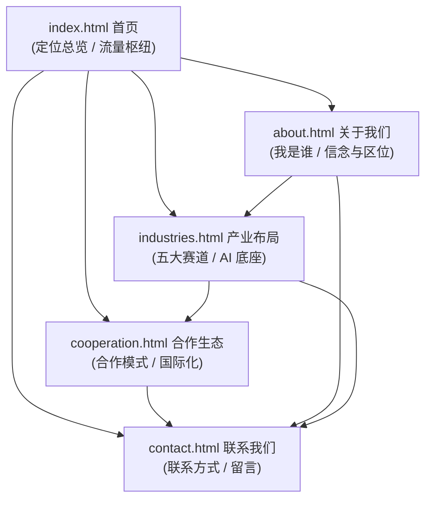

# 广东紫翔科技有限公司企业官网 — 架构设计文档

| 项目 | 内容 |
|---|---|
| 文档版本 | v1.0 |
| 撰写 | 顾图南（阿客实验室研发部） |
| 日期 | 2026-10-21 |
| 适用范围 | 官网首版（5 个静态页面）的信息架构、技术选型、设计系统、目录结构与实施约束 |
| 读者 | 前端工程师（苏映棠）、部署工程师（韩渡川）、验收工程师（关千锤）、总监（岑执衡） |
| 关联任务 | Phase 1 架构设计（本文档）→ Phase 2 前端实现 → Phase 3 部署 → Phase 4 验收 |

> 本文档是首版官网的唯一设计与实现依据。凡本文档未覆盖的细节，以前端工程师按"设计系统"章节的令牌与规范自行补齐为准，不得擅自偏离主色、字体、图标与目录约定。

---

## 1. 项目概述

### 1.1 项目背景

广东紫翔科技有限公司（Guangdong Zixiang Technology Co., Ltd.，品牌可缩写 ZIXIANG）总部位于广东省深圳市龙华区，是一家**跨领域产业融合发展型平台主体**：顶层公司研判形成项目机会，下沉到子公司放大；产业场景在技术层面打通；放大环节引入合作方赋能，把握不同赛道市场机会。

### 1.2 品牌定位一句话

**"AI+ 产业融合平台"** —— 依托自身人工智能等高新科技深耕，布局 AI+【低空经济 / 法律科技 / 新材料 / 整机与零部件产品 / 科技文化】等产业赛道，并参与大型发展基金、建立孵化器。

### 1.3 官网目标（首版）

1. 用 5 个静态页面清晰传达公司定位、信念与产业版图；
2. 面向政府与园区、投资机构、产业龙头、生态伙伴、人才五类受众建立专业可信的第一印象；
3. 为后续内容运营（案例、新闻、专题）预留信息架构扩展位；
4. 纯静态、零依赖、快速加载，可部署到任意静态托管环境。

### 1.4 目标受众

| 受众 | 核心关切 | 对应页面重心 |
|---|---|---|
| 政府与园区 | 是否紧跟国家战略、是否服务地方产业 | 首页定位区、关于我们（区位叙事）、产业布局 |
| 投资机构 | 商业模式是否成立、赛道是否有纵深 | 首页商业模式区、产业布局、合作生态 |
| 产业龙头 | 技术底座与场景打通能力 | 产业布局（AI 底座 + 五大赛道） |
| 生态伙伴 | 如何接入、如何被赋能 | 合作生态 |
| 人才 | 公司信念与发展空间 | 关于我们 |

---

## 2. 整站信息架构

### 2.1 站点地图



### 2.2 全局导航结构

**桌面端（≥1200px）**

```
┌──────────────────────────────────────────────────────────────┐
│ [Logo ZIXIANG]   首页  关于我们  产业布局  合作生态   [联系我们] │
└──────────────────────────────────────────────────────────────┘
```

- 左侧：SVG Logo（点击回首页）；
- 中部：5 个一级菜单，当前页以鎏金色下划线 + `aria-current="page"` 标识；
- 右侧：鎏金主按钮"联系我们"（`#` → contact.html）；
- 滚动超过 40px 时导航由"Hero 透明态"切换为"白底 + 细边框 + 轻阴影"（JS 添加 `.nav--scrolled`）。

**平板端（769px–1199px）**：保留 Logo + 5 项菜单（字号略减），CTA 按钮保留；视口 ≤1024px 可折叠为汉堡菜单（建议实现时以 1024px 为折叠阈值，保证菜单不换行）。

**移动端（≤768px）**：Logo + 汉堡按钮；点击展开全屏抽屉菜单（深藏青底、白色文字、菜单项纵向排列、当前页高亮）；抽屉展开时锁定 body 滚动，按钮切换为关闭图标，`aria-expanded` 同步。

### 2.3 全局页脚结构

四栏 + 底部行（深藏青 `#0A1A33` 底，白/浅灰文字）：

| 栏位 | 内容 |
|---|---|
| 品牌栏 | Logo（反白版）+ 一句话定位 + "高科技报国"信念短句 |
| 快速导航 | 首页 / 关于我们 / 产业布局 / 合作生态 / 联系我们 |
| 产业赛道 | AI+低空经济 / AI+法律科技 / AI+新材料 / AI+整机与零部件产品 / AI+科技文化（均指向 industries.html） |
| 联系我们 | 地址（占位：广东省深圳市龙华区，具体待客户提供）/ 电话（占位）/ 邮箱（占位） |

底部行：`© 2026 广东紫翔科技有限公司`（年份硬编码，见 §7 占位清单）· 备案号（占位：待客户提供）· 可选：隐私政策链接（暂以 `#` 占位，不建独立页面）。

### 2.4 页面间导览逻辑

1. **首页是枢纽**：每个内容区块尾部或卡片均带跳转入口，形成"首页速览 → 详情页深读"的漏斗；
2. **关于我们 → 产业布局**：区位与信念叙事收尾处引导"看看我们布局了哪些赛道"；
3. **产业布局 → 合作生态**：赛道介绍后引导"这些赛道如何与合作方共建"；
4. **合作生态 → 联系我们**：合作流程末尾即留言入口；
5. **任意页面 → 联系我们**：全局导航 CTA 与页脚常驻入口；
6. 禁止出现"死链接"：所有 `href` 要么指向站内真实页面，要么在 Phase 2 前替换为占位说明（见 §7）。

---

## 3. 页面清单与内容区块设计

> 每页统一含：`<header>` 全局导航 → `<main>` 页面内容 → `<footer>` 全局页脚。
> 页面首屏（Hero/页头横幅）统一使用深藏青渐变底 + 鎏金/科技蓝点缀；正文区使用浅色底 `#F7F9FC` 或白底卡片，形成"深-浅"节奏。

### 3.1 首页 `index.html`

**页面目标**：3 秒内传达"AI+产业融合平台"定位与"高科技报国"信念，建立专业可信气质，向四个内页分流。

| # | 区块名 | 内容要点 | 建议视觉形式 |
|---|---|---|---|
| 1 | 顶部导航 | 见 §2.2，Hero 上透明态 | 固定定位，透明 → 滚动变实 |
| 2 | Hero 主视觉 | 品牌 Slogan（建议："以AI之力，赴产业之兴"类表述，终稿文案由主理人审定）；副标题一句话定位："依托人工智能等高新科技，布局 AI+低空经济、法律科技、新材料、整机与零部件产品、科技文化等产业赛道"；双 CTA：主"了解产业布局"→ industries.html，次"联系我们"→ contact.html | 深藏青 → 科技蓝渐变底；装饰性内联 SVG（网格线 / 电路纹理 / 光晕圆），低透明度；大标题 H1 鎏金渐变文字或白字+鎏金关键词 |
| 3 | 定位速览带 | 4 个定性标签（非数字，避免虚构业绩）："深圳 · 运营总部" / "AI+ 产业融合平台" / "五大产业赛道" / "全球合作网络" | 横向 4 列，白底细卡片或深底分隔带；线性图标 + 文字 |
| 4 | 关于我们概览 | 公司简介 2-3 句（跨领域产业融合发展型平台主体 + 高科技报国信念）+ "了解更多"链接 → about.html | 左右分栏：左文右图（图用抽象 SVG 插画占位，不引用外部图片） |
| 5 | 产业布局速览 | 五大赛道卡片（低空经济 / 法律科技 / 新材料 / 整机与零部件产品 / 科技文化），每张：图标 + 名称 + 一句话方向；整组 CTA"查看完整产业布局"→ industries.html | 5 列卡片（移动端 1 列、平板 2-3 列），白卡 + 图标 |
| 6 | 商业模式图解 | 三段式流程："顶层研判，形成项目机会 → 下沉子公司，放大产业价值 → 引入合作方，赋能放大环节"；辅以一句"产业场景在技术层面打通" | 横向三步流程图（内联 SVG 连线 + 编号徽标）；或竖向步骤条（移动端） |
| 7 | 区位与国际化 | 左：区位叙事（深圳、改革开放前沿、粤港澳大湾区、"一带一路"桥头堡）；右：国际化（引入阿布扎比（阿联酋）、印度尼西亚等国家投资，与当地头部企业开展项目合作，助力内地扩大出口） | 左右分栏，浅蓝底纹；世界地图轮廓 SVG 装饰（仅作示意，不标具体数据） |
| 8 | 合作生态入口 | 一段引语 + "查看合作生态"→ cooperation.html；可列 3 类重点合作对象 | 深藏青底通栏 CTA 区，鎏金按钮 |
| 9 | 底部 CTA | "与我们对话" + 按钮 → contact.html | 可与区块 8 合并，避免页面过长 |
| 10 | 页脚 | 见 §2.3 | 深藏青 |

### 3.2 关于我们 `about.html`

**页面目标**：讲清楚"公司是谁、信什么、站在哪里、往哪里去"，支撑政府/园区/人才受众的信任判断。

| # | 区块名 | 内容要点 | 建议视觉形式 |
|---|---|---|---|
| 1 | 顶部导航 | 全局 | 滚动后白底态（本页 Hero 非全屏，导航初始即可为实色） |
| 2 | 页头横幅 | 标题"关于我们" + 一句话副题（高科技报国 · 立足粤港澳大湾区） | 深藏青渐变横幅（高度约 Hero 的 60-70%） |
| 3 | 公司简介 | 广东紫翔科技有限公司，总部深圳龙华；跨领域产业融合发展型平台主体；"高科技报国"信念；紧跟国家战略，推广战略性新兴产业在全国和全球的发展 | 单栏宽文本或左右分栏，正文 16px |
| 4 | 企业信念 | 三条：高科技报国 / 紧跟国家战略 / 推广战略性新兴产业（全国与全球） | 3 列图标卡片 |
| 5 | 区位叙事 | 深圳是中国产业与文化的代表，秉承改革开放前沿定位与国家赋予的创新使命；立足粤港澳大湾区，发挥广东及港澳"一带一路"桥头堡作用 | 左右分栏：文字 + 大湾区示意 SVG（抽象化，不标精确地理信息） |
| 6 | 发展路径 | 以阶段化方式描述（不写具体年份，年份待客户提供后补充）："从平台研判到多赛道落地"的脉络 | 竖向时间轴（节点文字待客户提供具体内容） |
| 7 | 组织与治理 | "顶层公司研判 + 子公司放大"的双层结构说明；不虚构人名与职数 | 结构示意图（内联 SVG 或 CSS 层级卡片） |
| 8 | 人才与未来 | 面向人才的价值观短句 + 引向 contact.html | 浅色收尾区 + CTA |
| 9 | 页脚 | 全局 | 深藏青 |

### 3.3 产业布局 `industries.html`

**页面目标**：证明"AI+ 技术底座"可向五大赛道复用，体现技术层面打通能力，打动产业龙头与投资机构。

| # | 区块名 | 内容要点 | 建议视觉形式 |
|---|---|---|---|
| 1 | 顶部导航 | 全局 | 同 about |
| 2 | 页头横幅 | 标题"产业布局" + 副题"一个 AI 底座，五条产业赛道" | 深藏青渐变横幅 |
| 3 | AI 技术底座 | 人工智能等高新科技作为底座：统一技术能力向上支撑各赛道；产业场景在技术层面打通 | 通栏说明 + 中心放射示意（内联 SVG：中心"AI 底座"向五条赛道连线） |
| 4 | 五大产业赛道 | 五张详情卡片（可按网格 2+3 或锚点导航）：**AI+低空经济** / **AI+法律科技** / **AI+新材料** / **AI+整机与零部件产品** / **AI+科技文化**；每张含：图标、赛道名、2-3 句方向性描述（具体业务内容待客户提供补充） | 卡片网格；每卡白底、顶部图标、hover 上浮；卡片内可加"了解更多"占位链接（暂 `#`，后续接案例页） |
| 5 | 产业融合模式 | 阐释"跨领域产业融合"：同一技术底座在多场景复用、互相增益 | 与首页区块 6 呼应的流程图变体 |
| 6 | 基金与孵化 | 参与大型发展基金、建立孵化器（不写基金名称与金额，待客户提供） | 双列卡片：发展基金 / 孵化器 |
| 7 | CTA | "共建产业生态" → cooperation.html | 深底 CTA 通栏 |
| 8 | 页脚 | 全局 | 深藏青 |

### 3.4 合作生态 `cooperation.html`

**页面目标**：把商业模式翻译成五类受众听得懂的"合作语言"，给出合作路径，导向联系。

| # | 区块名 | 内容要点 | 建议视觉形式 |
|---|---|---|---|
| 1 | 顶部导航 | 全局 | 同 about |
| 2 | 页头横幅 | 标题"合作生态" + 副题"与产业同路人，共赴长期价值" | 深藏青渐变横幅 |
| 3 | 合作方图谱 | 五类受众卡片：政府与园区 / 投资机构 / 产业龙头 / 生态伙伴 / 人才；每张：图标 + 一句话合作价值（不虚构承诺） | 5 列卡片（响应式降列） |
| 4 | 商业模式详解 | 三步闭环图解：① 顶层研判，形成项目机会 → ② 下沉子公司，放大产业价值 → ③ 放大环节引入合作方赋能；辅文说明"把握不同赛道市场机会" | 大号三步图解（桌面横向 / 移动竖向），编号 + 连线 |
| 5 | 国际化合作 | 引入阿布扎比（阿联酋）、印度尼西亚等国家投资；与当地头部企业开展项目合作；助力内地扩大出口；发挥广东及港澳"一带一路"桥头堡作用 | 左右分栏或地图示意；国家名仅作文本陈述，不做数据可视化 |
| 6 | 合作流程 | 建议四步：初步接洽 → 方向研判 → 方案共议 → 落地协作（具体流程待客户提供确认） | 横向步骤条 + 序号 |
| 7 | CTA | "成为合作伙伴" + 按钮 → contact.html；附一句引导话术 | 深底 CTA 通栏 + 鎏金按钮 |
| 8 | 页脚 | 全局 | 深藏青 |

### 3.5 联系我们 `contact.html`

**页面目标**：把沟通门槛降到最低，所有联系信息真实可用（占位信息须在交付前由客户提供并替换）。

| # | 区块名 | 内容要点 | 建议视觉形式 |
|---|---|---|---|
| 1 | 顶部导航 | 全局 | 同 about |
| 2 | 页头横幅 | 标题"联系我们" + 副题"期待与您对话" | 深藏青渐变横幅 |
| 3 | 联系信息 | 公司全称（中英文）；地址：广东省深圳市龙华区（详细地址待客户提供）；电话：待客户提供；邮箱：待客户提供；办公时间：待客户提供 | 3-4 个信息卡（图标 + 标签 + 值），白卡横排 |
| 4 | 在线留言 | 表单字段：姓名*、单位/机构、联系电话、电子邮箱*、合作意向类型（下拉：政府与园区/投资机构/产业龙头/生态伙伴/人才/其他）、留言内容*；提交按钮；隐私提示一句 | 左右分栏：左表单右信息卡；输入框 44px 高、1px 边框、focus 时科技蓝描边；**提交方式待定（见 §7）**，前端先做本地校验 |
| 5 | 位置示意 | 不引入任何外部地图 SDK/CDN；以"深圳龙华 · 运营总部"文字卡 + 抽象区位 SVG 呈现 | 静态占位区块，明确标注"地图待接入" |
| 6 | 页脚 | 全局 | 深藏青 |

---

## 4. 技术选型与约束

### 4.1 技术栈（硬性约束）

| 项 | 约定 | 说明 |
|---|---|---|
| 标记 | HTML5 | 语义化标签（见 §8） |
| 样式 | CSS3 | 手写单文件 `assets/css/style.css`，CSS 自定义属性承载设计令牌 |
| 脚本 | 原生 JavaScript（ES2017+） | 单文件 `assets/js/main.js`，禁框架、禁打包 |
| 构建 | **无构建步骤** | 交付物即源码，直接可开可部署 |
| 外部依赖 | **零外部 CDN、零外链字体、零第三方 SDK** | 图标一律内联 SVG 或本地 SVG 文件；**不接高德/百度/Google 地图** |
| 字体 | 系统字体栈 | 见 §5.2 |
| 图片 | 本地 SVG / 栅格化占位 | 大图位用 SVG 插画或纯 CSS 图形占位 |
| 兼容 | 现代浏览器最近两个大版本 | Chrome / Edge / Firefox / Safari；不承诺 IE |

### 4.2 响应式断点

| 断点 | 范围 | 布局策略 |
|---|---|---|
| 桌面 | ≥1200px | 多列网格、完整导航、Hero 全宽 |
| 平板 | 769px–1199px | 列数减半（2 列卡片）、导航 ≤1024px 折叠为汉堡 |
| 手机 | ≤768px | 单列纵向流、汉堡菜单、字号降档、间距收紧 |

实现方式：CSS 媒体查询 + `clamp()` 做流式字号；移动优先或桌面优先均可，但**全站断点值必须统一为上述三档**，禁止出现第四档魔法值。

### 4.3 JS 职责范围（main.js）

仅限：导航滚动态切换、移动端菜单开合（含 aria、body 锁滚动）、当前导航高亮（可由 HTML `aria-current` 直接实现则不必 JS）、表单本地校验与占位提交反馈、页脚年份（若不用硬编码则 JS 注入）、`prefers-reduced-motion` 场景降级。**禁止**：自动轮播、复杂动画库、任何网络请求。

---

## 5. 设计系统

### 5.1 色彩令牌

主色系：深藏青（权威、产业感）；科技蓝（AI、行动点）；鎏金（高端点缀）；内容区浅色（阅读舒适）。

```css
:root {
  /* 深藏青 · 主色 */
  --color-primary-900: #0A1A33;   /* 页脚 / 深端渐变 */
  --color-primary-800: #0E2240;   /* 主色：Hero、页头横幅 */
  --color-primary-700: #16305A;   /* 悬浮层、卡片深色变体 */
  --color-primary-600: #1F3D6E;   /* 深底上的次级面板 */

  /* 科技蓝 · 强调与行动 */
  --color-accent-blue: #2E6BF0;   /* 链接、focus、图标强调 */
  --color-accent-blue-hover: #1F5AD8;
  --color-accent-blue-light: #E9F0FE; /* 浅蓝底纹区块 */

  /* 鎏金 · 点缀 */
  --color-gold: #C9A15C;          /* 主 CTA 底、分隔线、当前导航标识 */
  --color-gold-hover: #B78E4A;
  --color-gold-light: #F6EFE2;    /* 鎏金浅底 */

  /* 内容区浅色 */
  --color-bg: #F7F9FC;            /* 页面浅底 */
  --color-surface: #FFFFFF;       /* 卡片 */

  /* 文字 */
  --color-text-primary: #17203A;  /* 标题/正文 */
  --color-text-secondary: #5B6478;/* 辅助说明 */
  --color-text-on-dark: #E9EEF7;  /* 深底主文字 */
  --color-text-on-dark-secondary: #A8B4C9; /* 深底辅助文字 */

  /* 边框 */
  --color-border: #E2E8F0;
  --color-border-strong: #CBD5E1;

  /* 功能色（表单反馈） */
  --color-success: #1F9D63;
  --color-error: #C0392B;
}
```

**使用规则**：
1. 深藏青只用于"氛围区"（Hero、页头横幅、CTA 通栏、页脚）；正文内容一律浅底，保证长文可读性；
2. 鎏金是点缀色，单屏出现面积 ≤5%，不用于大面积底色（CTA 按钮除外）；
3. 深底上的正文用 `--color-text-on-dark`；金色文字仅用于深底上的短词/关键词（`#C9A15C` on `#0E2240` 对比度约 6.4:1，满足 AA）；
4. 对比度底线：正文 ≥4.5:1，大字（≥24px 或 ≥19px 粗体）≥3:1；`#5B6478` on `#F7F9FC` 约 5.4:1，达标。

### 5.2 字体层级

```css
:root {
  --font-family: -apple-system, BlinkMacSystemFont, "Segoe UI", Roboto,
    "PingFang SC", "Hiragino Sans GB", "Microsoft YaHei", "Noto Sans CJK SC",
    "Helvetica Neue", Arial, sans-serif;
}
```

| 层级 | 字号（桌面 / 手机） | 字重 | 行高 | 颜色 | 用途 |
|---|---|---|---|---|---|
| H1 | 52px / 32px（建议 `clamp(32px, 5vw, 52px)`） | 700 | 1.25 | 深底：`--color-text-on-dark`；浅底：`--color-text-primary` | 每页唯一，Hero/页头主标题 |
| H2 | 36px / 26px（`clamp(26px, 3.5vw, 36px)`） | 700 | 1.3 | `--color-text-primary` | 区块标题 |
| H3 | 22px / 20px | 600 | 1.35 | `--color-text-primary` | 卡片标题 |
| H4 | 18px | 600 | 1.4 | `--color-text-primary` | 卡片内小标题、表单分组 |
| 正文 | 16px | 400 | 1.75 | `--color-text-secondary` | 段落 |
| 强调正文 | 16px | 500 | 1.75 | `--color-text-primary` | 关键词句 |
| 辅助 | 14px | 400 | 1.6 | `--color-text-secondary` | 说明、表单标签 |
| 页脚/小字 | 13px | 400 | 1.6 | 深底 `--color-text-on-dark-secondary`；浅底 `--color-text-secondary` | 版权、备案 |

规则：全站字号仅允许上表取值（流式字号用 clamp 线性过渡，不新增中间档）；中文不斜体、不全大写、不加粗斜体组合。

### 5.3 间距体系

4px 基数，全站只允许以下取值：`4 / 8 / 12 / 16 / 24 / 32 / 40 / 48 / 64 / 80 / 96 / 128px`。

| 场景 | 取值 |
|---|---|
| 区块垂直内边距（桌面 / 手机） | 96px / 56px |
| 区块间距 | 64px |
| 卡片内边距 | 24–32px |
| 卡片网格间距 | 24px |
| 标题与正文间距 | 16px |
| 表单字段间距 | 20–24px |
| 页脚栏间距 | 48px |

### 5.4 圆角

| 令牌 | 值 | 用途 |
|---|---|---|
| `--radius-sm` | 6px | 小元素、标签、输入框 |
| `--radius-md` | 10px | 按钮 |
| `--radius-lg` | 16px | 卡片、通栏容器 |
| `--radius-pill` | 999px | 胶囊标签 |

### 5.5 阴影

| 令牌 | 值 | 用途 |
|---|---|---|
| `--shadow-sm` | `0 1px 2px rgba(10,26,51,.06)` | 卡片静息 |
| `--shadow-md` | `0 4px 16px rgba(10,26,51,.08)` | 卡片 hover、下拉 |
| `--shadow-lg` | `0 12px 32px rgba(10,26,51,.12)` | 模态、悬浮层（如需） |

规则：阴影颜色一律用深藏青的透明黑（`rgba(10,26,51,…)`），不用纯黑；深底区块不加阴影。

### 5.6 按钮规范

| 类型 | 外观 | 尺寸 | 状态 |
|---|---|---|---|
| 主按钮（鎏金） | 底 `--color-gold`，字 `--color-primary-900`，无边框 | 高 48px（桌面）/44px（手机），padding 0 24px，`--radius-md` | hover：底 `--color-gold-hover` + `translateY(-1px)` + `--shadow-md`，transition 200ms |
| 次按钮（描边） | 透明底，1px 边框（深底上用白/浅灰边，浅底上用 `--color-primary-800` 边），文字同边框色 | 同上 | hover：底变半透明主色 8% |
| 文字链接 | 无底色，`--color-accent-blue`，带右箭头图标 | 行高 1.6 | hover：下划线 + 箭头位移 2px |

通用：`focus-visible` 时 2px `--color-accent-blue` 外描边 + 2px 偏移；按钮内图标 20px、与文字间距 8px；全站按钮文案不用感叹号。

### 5.7 卡片规范

- 白底 `--color-surface`，1px `--color-border`，`--radius-lg`，`--shadow-sm`，内边距 24–32px；
- hover（可点击卡片）：`translateY(-2px)` + `--shadow-md` + 边框色 `--color-border-strong`，transition 200ms；
- 卡片结构自上而下：图标（32px，鎏金或科技蓝）→ 标题（H3）→ 正文（辅助色）→ 可选链接；
- 赛道卡/合作卡在深底通栏内出现时，用 `--color-primary-700` 底 + 白字变体。

### 5.8 图标规范（线性图标）

- 网格：24×24 viewBox，内容居中对齐 24px 网格；
- 描边：`fill="none"`、`stroke="currentColor"`、`stroke-width="1.8"`、`stroke-linecap="round"`、`stroke-linejoin="round"`；
- 风格：统一线性、圆角线帽、不混用填充图标；
- 颜色：默认继承文字色；强调处用鎏金或科技蓝；
- 交付：本地 SVG 文件存放于 `assets/img/icons/`，页面中以内联 `<svg>` 方式使用（便于 currentColor 继承）；装饰性图标必须 `aria-hidden="true"`，有语义的配 `aria-label` 或用 `<title>`；
- 首版必需图标清单：AI 核心、低空经济（飞行器/空域）、法律科技（天平/盾）、新材料（分子/层叠）、整机与零部件（齿轮/芯片）、科技文化（光芒/书本）、全球/国际化、合作（握手/链接）、基金（增长/钱币）、孵化器（萌芽/层级）、地点、电话、邮件、右箭头、菜单、关闭、对勾、用户、机构。

### 5.9 布局栅格与容器

- 内容最大宽度 1200px，两侧留白 24px（手机 20px）；
- 桌面网格：12 列；常用卡片网格：2 列 / 3 列 / 5 列（响应式降为 2→1）；
- Hero 与页头横幅：全宽深底，内部容器同 1200px；
- 深-浅交替节奏：深底通栏（Hero/CTA/页脚）与浅底区块（内容）交替，相邻两个浅底区块之间用细边框或 8px 底色差区分。

---

## 6. 目录结构与文件组织

```
zixiang-website/
├── index.html                  # 首页
├── about.html                  # 关于我们
├── industries.html             # 产业布局
├── cooperation.html            # 合作生态
├── contact.html                # 联系我们
├── assets/
│   ├── css/
│   │   └── style.css           # 全站样式（设计令牌 + 组件 + 页面）
│   ├── js/
│   │   └── main.js             # 全站脚本（导航/菜单/表单）
│   └── img/
│       ├── logo.svg            # 主 Logo（深底/浅底两版可合并或分文件）
│       ├── logo-mark.svg       # 仅图形标（favicon、页脚简版用）
│       ├── favicon.svg         # 站点图标
│       └── icons/              # 线性图标库（§5.8 清单）
│           ├── ai-core.svg
│           ├── low-altitude.svg
│           ├── legal-tech.svg
│           ├── material.svg
│           ├── hardware.svg
│           ├── culture.svg
│           ├── global.svg
│           ├── handshake.svg
│           ├── fund.svg
│           ├── incubator.svg
│           ├── location.svg
│           ├── phone.svg
│           ├── mail.svg
│           ├── arrow-right.svg
│           ├── menu.svg
│           ├── close.svg
│           ├── check.svg
│           ├── user.svg
│           └── building.svg
└── docs/
    └── architecture.md         # 本文档（设计与实现依据）
```

**组织规则**：
1. 根目录只放 5 个页面 HTML，不加子目录分层（静态小站扁平化，利于直接部署与相对路径稳定）；
2. CSS/JS 各只有一个文件，内部按"令牌 → 基础 → 布局 → 组件 → 页面 → 响应式"分节注释；
3. 所有站内引用用相对路径（`assets/css/style.css`、`./about.html`），不出现绝对路径与协议头混合引用；
4. 新增页面（如未来的新闻/案例页）放根目录，并在页脚"快速导航"登记。

---

## 7. 每页 SEO 基础

### 7.1 公共约定

- 每页 `<html lang="zh-CN">`；
- `<meta name="viewport" content="width=device-width, initial-scale=1">`；
- `<meta charset="UTF-8">`；
- description 控制在 70–120 个中文字符；
- 每页一个 H1；标题层级不跳级；
- favicon：`assets/img/favicon.svg`（另建议交付一枚 PNG 兜底，由前端转出）；
- 社交分享用基础 OG 标签（og:title / og:description / og:type=website），og:image 待客户提供品牌图后补充。

### 7.2 各页 title 与 description 草案

| 页面 | `<title>` | `<meta name="description">` |
|---|---|---|
| 首页 | 广东紫翔科技有限公司 — AI+产业融合发展平台 · 官方网站 | 广东紫翔科技有限公司总部位于深圳，依托人工智能等高新科技，布局AI+低空经济、法律科技、新材料、整机与零部件产品、科技文化等产业赛道，构建跨领域产业融合发展平台，与生态伙伴共赢。 |
| 关于我们 | 关于我们 — 高科技报国 · 立足粤港澳大湾区 · 广东紫翔科技有限公司 | 广东紫翔科技秉承高科技报国信念，紧跟国家战略，推广战略性新兴产业在全国和全球的发展；立足深圳，发挥粤港澳大湾区与"一带一路"桥头堡优势。 |
| 产业布局 | 产业布局 — AI+低空经济/法律科技/新材料/整机与零部件产品/科技文化 · 广东紫翔科技 | 以人工智能为统一技术底座，广东紫翔科技布局AI+低空经济、法律科技、新材料、整机与零部件产品、科技文化五大产业赛道，并参与大型发展基金、建立孵化器。 |
| 合作生态 | 合作生态 — 与政府园区、投资机构、产业龙头、生态伙伴共建 · 广东紫翔科技 | 顶层研判、子公司放大、合作方赋能：了解广东紫翔科技的跨领域产业融合模式与国际化合作布局，携手把握不同赛道市场机会。 |
| 联系我们 | 联系我们 — 广东紫翔科技有限公司 · 深圳龙华运营总部 | 联系广东紫翔科技有限公司：在线留言、电话与邮箱（联系方式以官网公示为准），期待与政府园区、投资机构、产业龙头、生态伙伴及人才对话。 |

> 以上文案为草案，突出"AI+产业融合平台"定位；正式上线前由主理人终审，关键词不做堆砌。

---

## 8. 性能与可访问性基线

### 8.1 性能

1. 零外部请求（无 CDN、无外链字体、无第三方 SDK），首屏关键路径仅 1 个 CSS + 1 个 JS；
2. CSS 置于 `<head>`，JS 置于 `</body>` 前（或加 `defer`）；
3. 图片/插画一律 SVG 或 CSS 图形；若后续引入位图，必须 `loading="lazy"` + `width/height` 属性防抖；
4. 动效克制：过渡 ≤300ms；禁止自动轮播、禁止视差滚动、禁止连续无限动画；`@media (prefers-reduced-motion: reduce)` 下全部动画/过渡降为即时；
5. 单页 HTML 体积目标 ≤120KB（含内联 SVG），CSS ≤60KB，JS ≤16KB（gzip 前）。

### 8.2 可访问性

1. 语义化结构：`header / nav / main / section / article / footer` 成对使用；每页一个 `main`、一个 `h1`；
2. 图片：所有 `` 有 `alt`（装饰图 `alt=""`）；内联 SVG 装饰 `aria-hidden="true"`；
3. 交互：汉堡按钮 `aria-expanded` + `aria-controls`；当前导航项 `aria-current="page"`；全站可键盘操作，`focus-visible` 可见；
4. 色彩对比度按 §5.1 规则执行，正文 ≥4.5:1；
5. 表单：`label` 关联控件（`for/id`），必填项标注 `required` + 视觉标识，错误提示文字关联 `aria-describedby`；
6. 动效与闪烁：无频闪元素；`prefers-reduced-motion` 必须实现；
7. 跳转链接：页面提供"跳到主内容"的 skip link（视觉隐藏，聚焦可见）。

---

## 9. 占位信息清单（统一标注"待客户提供"）

以下信息**严禁虚构**，页面中先以占位形式呈现，客户提供后由前端统一替换：

| 占位项 | 页面位置 | 占位呈现方式 |
|---|---|---|
| 详细办公地址（深圳市龙华区以下） | contact 联系信息卡、页脚 | "广东省深圳市龙华区（详细地址待客户提供）" |
| 联系电话 | contact、页脚 | "待客户提供" |
| 企业邮箱 | contact、页脚 | "待客户提供" |
| 办公时间 | contact | "待客户提供" |
| ICP 备案号 | 页脚底部行 | "备案号待客户提供" |
| 公安备案号（如有） | 页脚底部行 | "待客户提供（如有）" |
| 成立年份 / 发展里程碑具体年份 | about 发展路径 | 阶段化文字描述，不写年份；客户提供后在时间轴节点补年份 |
| 业绩/规模数字（营收、规模、案例数等） | 全站 | **一律不写数字**，用定性表述 |
| 表单提交方式（mailto / 后端接口） | contact | 前端先做本地校验，提交行为以占位提示"提交功能待接入" |
| 社交媒体链接（如有） | 页脚 | 无则不展示 |
| og:image 品牌分享图 | 全站 meta | 暂缺，客户提供品牌图后补 |
| 英文公司名规范写法 | contact、页脚 | Guangdong Zixiang Technology Co., Ltd.（brief 给定，可直接用） |
| 隐私政策/使用条款页面 | 页脚 | 暂以 `#` 占位或暂不展示 |

---

## 10. 内容红线（编写与验收共同遵守）

1. **不虚构**：不编造业绩数字、融资/基金金额、客户与案例名称、成立及发展年份、人名与职务；
2. **不出现真实政治人物姓名**；
3. **规范表述固定使用**："战略性新兴产业""改革开放前沿""粤港澳大湾区""一带一路"（带引号）；
4. 区位与国际化表述以 brief 为唯一事实来源：深圳龙华总部、广东及港澳"一带一路"桥头堡、阿布扎比（阿联酋）与印度尼西亚等国家投资与合作；
5. 商业模式表述固定为：顶层公司研判形成项目机会 → 下沉到子公司放大 → 产业场景在技术层面打通 → 放大环节引入合作方赋能；
6. 合作类文案不得承诺收益、份额或政策待遇；
7. 五大赛道名称固定为：低空经济、法律科技、新材料、整机与零部件产品、科技文化（前缀统一"AI+"）；
8. 口号类文案（Slogan）需主理人终审后定稿，本文档中的示例仅为建议。

---

## 11. 给前端工程师的实施顺序建议

1. 搭目录与 5 个 HTML 骨架，先接好全局导航/页脚（先保证站点可整体浏览）；
2. 落 `style.css` 令牌层（照抄 §5 数值），再写基础与布局；
3. 按"首页 → 关于我们 → 产业布局 → 合作生态 → 联系我们"顺序逐页实现；
4. 每完成一页，自检：SEO 三要素、语义标签、对比度、响应式三档、占位信息是否标注；
5. `main.js` 最后接入（导航态、菜单、表单校验）；
6. 完成后对照 §7/§8/§9/§10 逐页打钩，提交 Phase 4 验收。

## 12. 验收对照清单（Phase 4 输入）

- [ ] 5 个页面均可达，导航/页脚全局一致，无死链（占位 `#` 除外且已登记）
- [ ] 设计令牌与本文档 §5 完全一致（色值/字号/间距/圆角/阴影）
- [ ] 图标符合 24px 网格、stroke 1.8、圆角线帽规范
- [ ] 三档响应式断点表现正常（≥1200 / 769–1199 / ≤768）
- [ ] 每页 title/description 与 §7.2 一致或经主理人确认的修订版
- [ ] 语义化、alt/aria、focus 可见、prefers-reduced-motion 均落实
- [ ] 无任何外部请求（断网可完整浏览）
- [ ] 占位信息清单（§9）全部以"待客户提供"标注，无虚构数字与年份
- [ ] 内容红线（§10）逐条通过

---

*本文档由顾图南撰写，作为官网首版架构与设计的唯一依据；如需调整，请走文档变更（改版本号 + 变更说明），勿口头约定。*
